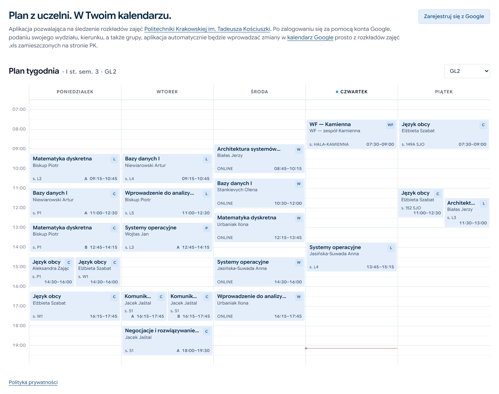
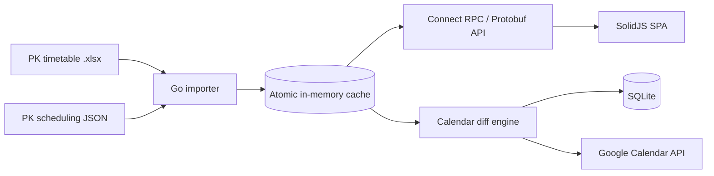

# PlanerPK

**Your university timetable, living in your Google Calendar.**

[](https://planpk.gami.ovh)
[](#tech-stack)
[](#tech-stack)
[](#tech-stack)
[](#deployment)

### [Open the live app → planpk.gami.ovh](https://planpk.gami.ovh)



## Overview

PlanerPK is a full-stack service that keeps a student's Google Calendar in sync
with the official timetable published by Politechnika Krakowska (CUT). It parses
the university's Excel workbook and scheduling JSON, resolves every class to
dated meetings, and continuously reconciles a dedicated Google Calendar — so the
schedule stays current without manual copying.

PlanerPK currently supports the **Informatyka** programme. Students sign in with
Google, choose their year, semester, and group, and get a live timetable preview
they can customize: hide classes, shift start times, make events transparent, or
add a class from another group. Everything else — recurring series, A/B weeks,
semester halves, room changes, and last-minute updates — is handled
automatically.

## Highlights

- **Two-source timetable importer** — merges Excel (group membership and class
  details) with the publisher's JSON snapshot (dated schedules), so weekly
  series and concrete-date classes are modeled correctly instead of guessed.
- **Idempotent, diff-based calendar sync** — compares the desired event content
  with the live calendar and only creates, patches, or deletes what changed.
  User-added reminders and other unrelated fields are preserved.
- **Real recurrence semantics** — bounded `RRULE`s, A/B teaching-week parity,
  semester halves, full-day and partial-day closures via `EXDATE`, and
  timezone-safe `Europe/Warsaw` timestamps across DST.
- **Change detection before API calls** — SHA-256 hashes of the workbook and the
  publisher snapshot skip scheduled Google requests when upstream data has not
  changed, keeping sync cheap and quiet.
- **Per-user customization** — hide a class, shift its start time, make it
  transparent ("ghost"), or import a class from another group, all without
  mutating the shared cached timetable.
- **Least-privilege OAuth** — requests only `calendar.app.created` (plus
  `email`/`profile`), allowing the app to create and manage its own secondary
  calendar while being unable to read any other calendar belonging to the user.
- **Concurrency-safe cache** — atomic pointer swaps give every request a
  consistent snapshot while refreshes happen in the background.
- **Deployment-ready** — multi-stage Docker image and Docker Compose support with
  a persistent data volume.
- **Broad automated tests** — table-driven Go tests across parsing, matching,
  scheduling, sync, and HTTP behavior, plus frontend tests for timetable
  positioning and selection logic.

## Known limitation

Google Maps links are currently unavailable. The university's updated Excel
format removed the classroom legend that powered classroom-to-building matching,
so the Google Places integration is dormant and events keep only the original
room/location text. Timetable sync is unaffected.

## Architecture



The importer builds one consistent timetable before publishing it, so reads
never observe a partially rebuilt cache. Calendar synchronization runs per user,
reloads that user's settings and overrides, and writes only the necessary changes
to their dedicated PlanerPK calendar.

## Tech stack

| Layer | Technology |
| --- | --- |
| Backend | Go 1.26, Connect RPC, Protobuf, `log/slog` |
| Frontend | SolidJS, TypeScript, StyleX, Vite |
| Data | SQLite (`modernc.org/sqlite`, WAL), `excelize` for XLSX parsing |
| Integrations | Google Calendar API, OAuth 2.0 |
| Infrastructure | Multi-stage Docker, Docker Compose |
| Tooling | Buf, sqlc, pnpm, gofumpt, ESLint, Prettier |

## Project layout

| Path | Purpose |
| --- | --- |
| `backend/` | Go service: importer, matching, cache, calendar sync, RPC handlers |
| `frontend/` | SolidJS single-page app and design system |
| `proto/` | Protobuf service and message definitions |
| `static/` | Built frontend assets served by the backend |
| `Dockerfile` | Reproducible multi-stage build for the full application |

## Deployment

PlanerPK is meant to be deployed via Docker using the repository `Dockerfile`.
The multi-stage image builds the SolidJS frontend and compiles the Go backend.
The container serves compiled assets from its internal `static` directory and
keeps all mutable runtime data under `DATA_DIR` (default `/data`), which should
be mounted as one persistent volume. The data directory stores the SQLite
database, logs, cached state, and downloaded timetables.

The OAuth `credentials.json` file should be mounted read-only and is never
included in the image. It requests only the calendar and profile scopes needed
to create and manage PlanerPK's own calendar.

### Build the image

```sh
docker build -t planer-pk .
```

### Run with Docker Compose

Example `docker-compose.yml` configuration:

```yaml
services:
  app:
    build:
      context: .
      dockerfile: Dockerfile
    image: planer-pk:latest
    container_name: planer-pk
    ports:
      - "8080:8080"
    environment:
      API_BASE_URL: "http://localhost:8080/api"
      LOG_LEVEL: "INFO"
      MINUTES_BETWEEN: "5"
      TZ: "Europe/Warsaw"
    volumes:
      - ./data:/data
      - ./credentials.json:/data/credentials.json:ro
    restart: unless-stopped
```

Start the application with:

```sh
docker compose up --build
```

The container listens on port `8080`. `API_BASE_URL` is substituted into the
built frontend at startup and should point at the deployment, for example
`https://planpk.gami.ovh/api`.

### Runtime settings

- `DATA_DIR` — mutable data root; defaults to `/data`.
- `LOG_LEVEL` — `DEBUG`, `INFO`, `WARN`, or `ERROR`.
- `MINUTES_BETWEEN` — timetable refresh interval; unchanged data skips scheduled calendar sync.
- `TZ` — process timezone; use `Europe/Warsaw` for class dates and DST.
- `TIMETABLE_URL` — direct timetable download URL.
- `DISCORD_WEBHOOK_URL` — optional Discord webhook for error notifications.

## Development

Backend checks:

```sh
cd backend
go test ./...
```

Protobuf generation is run from the repository root with
`buf generate --template buf.gen.yaml` and writes to `backend/gen` and
`frontend/src/gen`.

## Privacy

PlanerPK requests the minimum Google Calendar permission needed to create and
maintain its own dedicated calendar. It does not read the user's other
calendars. The public privacy policy is available at
[planpk.gami.ovh/privacy-policy](https://planpk.gami.ovh/privacy-policy).
